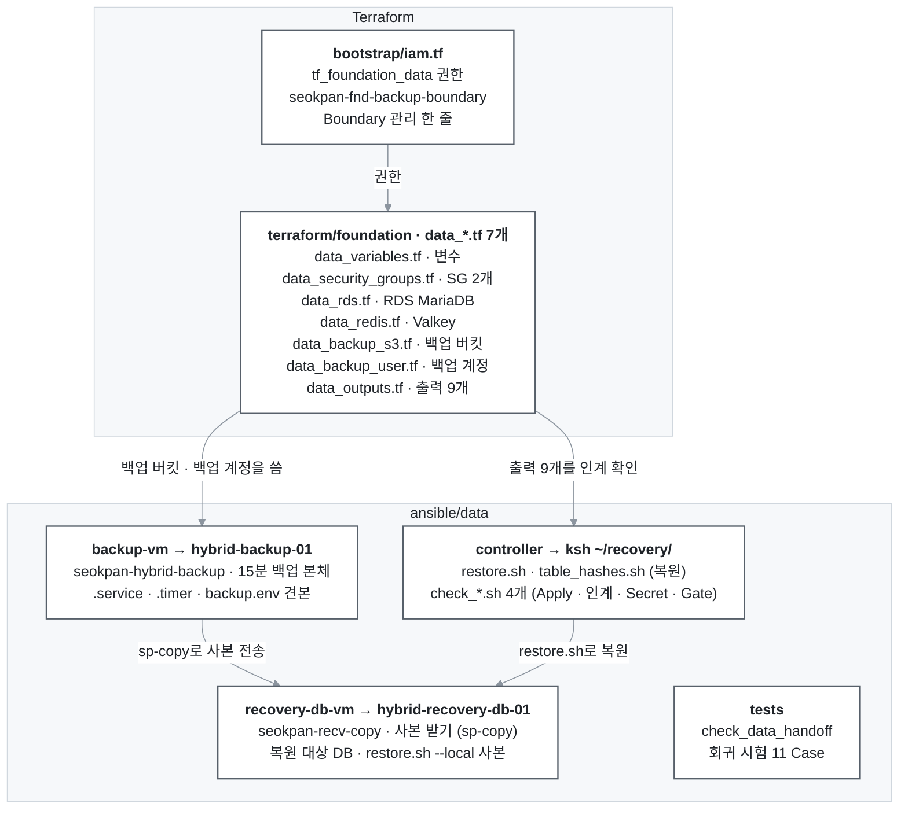
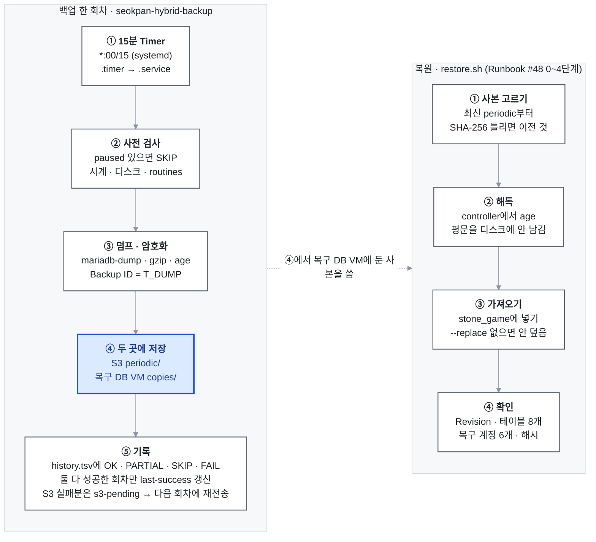

# hybrid-infra Data 코드 설명 (통화용)

2026-10-14 · 김상희

## 통화 순서와 한 줄 요약

**한 줄 요약:** Terraform 코드는 AWS에 Data 자리(RDS · Valkey · 백업 S3 · 백업 계정)를 만들고, `ansible/data` 스크립트는 15분마다 백업을 떠서 S3와 온프렘 복구 DB VM 두 곳에 남기며, 장애 때는 `restore.sh`로 복구 DB VM에 되살립니다.

기준은 [seokpan-hybrid-infra](https://github.com/seokpan/seokpan-hybrid-infra) main 브랜치 커밋 `0b4497d`입니다(2026-10-14에 실제 파일을 열어 확인). 통화할 때 [ansible/data/README.md](https://github.com/seokpan/seokpan-hybrid-infra/blob/main/ansible/data/README.md)를 같이 띄워 두면 설명하기 편합니다.

1. 아래 구조 그림으로 파일이 어디 있고 서로 무엇을 쓰는지부터 설명
2. Terraform: bootstrap의 Data 권한 → foundation의 `data_` 파일 7개
3. ansible/data: 폴더 4개와 서버 설치 위치
4. 백업 한 회차와 복원이 어떤 순서로 도는지
5. 고칠 때 규칙, 받을 만한 질문

## 한눈에 보는 구조

위쪽 Terraform은 AWS에 "자리"만 만들고 데이터나 비밀번호는 보지 못합니다. 아래쪽 `ansible/data`는 그 자리를 실제로 쓰는 스크립트이고, 각 폴더 이름이 곧 설치될 서버 이름입니다. 같은 foundation 폴더에 있어도 `network*.tf`(이유빈), registry · CI IAM(최유준), `rosa_iam_*`는 제 파일이 아닙니다.

## 1. Terraform — AWS에 Data 자리를 만드는 코드

Terraform 폴더는 `bootstrap` → `foundation` → `rosa` 순서로 Apply합니다. 제가 쓴 것은 bootstrap의 `iam.tf` 안 Data 권한 블록과, foundation 안에서 `data_`로 시작하는 파일 7개입니다. 파일 머리마다 `# 작성자: 김상희` 주석이 있어 구분할 수 있습니다.

### 1-1. bootstrap/iam.tf — Data 권한 (파일 하나 안의 블록 3개)

| 블록 (AWS 이름) | 하는 일 |
| --- | --- |
| `tf_foundation_data` → `seokpan-tf-foundation-data` | foundation Role이 Data 자원을 만들 수 있게 허용. 이름이 `seokpan-fnd-*`인 자원만 다룸 |
| `backup_boundary` → `seokpan-fnd-backup-boundary` | 백업 계정이 가질 수 있는 최대 권한. 백업 버킷 올리기 · 받기 · 목록만, 삭제 금지와 HTTPS 강제는 explicit Deny |
| `tf_bootstrap` 안 한 줄 (2026/10/06 주석) | bootstrap Role이 위 Boundary 정책을 관리할 수 있게 ARN 추가 |

일부러 뺀 권한도 설명해 주세요. 백업 객체 읽기 · 쓰기 · 삭제, `GetSecretValue`, `CreateAccessKey`, `RestoreDBInstance*`, `TestFailover`, `CreateServiceLinkedRole`이 없습니다. 그래서 Terraform을 돌리는 사람도 백업 내용과 DB 비밀번호를 볼 수 없습니다. 권한은 실제로 AccessDenied가 난 Action만 하나씩 보강하는 원칙입니다.

### 1-2. foundation/data\_\*.tf — 파일 7개

| 파일 | 만드는 것 (AWS 이름) | 기억할 점 |
| --- | --- | --- |
| `data_variables.tf` | 변수와 공통 값 | 이름 접두사 `seokpan-fnd`는 bootstrap 권한 패턴과 묶여 있어 local로 고정. Data 변수는 `rds_` · `redis_` · `backup_`로 시작. Redis Token 변수는 기본값이 없어 Token 없이 Plan하면 멈춤 |
| `data_security_groups.tf` | SG `seokpan-fnd-rds` · `seokpan-fnd-redis`, 온프렘 Data VM → RDS 3306 규칙 | 규칙은 모두 별도 Rule 리소스. ROSA Worker → Data 규칙은 rosa State가 붙이기 때문에 inline으로 쓰면 foundation Apply 때 지워 버림. egress 없음, 온프렘 → Redis 직접 접근 없음. 공통 변수 `onprem_job_host_cidrs`가 비어 있으면 규칙이 안 생김 |
| `data_rds.tf` | Subnet Group `seokpan-fnd-data`, Parameter Group `seokpan-fnd-mariadb118`, DB `seokpan-fnd-mariadb` | MariaDB 11.8.9 · db.t4g.small · Multi-AZ · gp3 20GiB(자동 확장 끔). 시간대 Asia/Seoul · SQL Mode · utf8mb4를 1차와 같게 맞춤. `require_secure_transport=1`은 영구 드리프트를 막으려고 `pending-reboot`로 적음. 마스터 비밀번호는 RDS가 만들어 Secrets Manager에 보관. 자동 백업 7일, 삭제 보호 켬, 최종 스냅샷 `seokpan-fnd-mariadb-final` |
| `data_redis.tf` | Subnet Group, Parameter Group · Replication Group `seokpan-fnd-redis` | 엔진은 Valkey 7.2, 이름의 redis는 계층 이름. cache.t4g.small, Primary 1 + Replica 1 · Multi-AZ 자동 승격, TLS + AUTH. Token은 `auth_token_wo`라 State에 안 남고, 바꿀 때 `redis_auth_token_version`을 1 올림. `noeviction`, 스냅샷 0 |
| `data_backup_s3.tf` | 버킷 `seokpan-fnd-backup-<계정 ID>`와 버전 관리 · 암호화 · 공개 차단 · 소유권 · Lifecycle | `periodic/`은 7일 뒤 자동 삭제, `protected/`는 자동 삭제 없음. 버킷 정책은 두지 않음(HTTPS · 삭제 금지는 Boundary가 담당). `force_destroy=false`라 객체가 있으면 버킷이 안 지워짐 |
| `data_backup_user.tf` | IAM User `seokpan-fnd-backup`, inline 정책 `seokpan-fnd-backup-s3` | Boundary가 붙어야만 만들 수 있음. 올리기는 `periodic/`만, 받기 · 목록은 `periodic/` · `protected/`. 삭제 권한 없음. Access Key는 Secret이 State에 남지 않도록 Terraform 밖에서 발급 |
| `data_outputs.tf` | 출력 9개 | RDS SG · Redis SG ID, RDS 주소 · 포트 · 마스터 Secret ARN, Redis Primary Endpoint · 포트, 백업 버킷 · 계정 이름. 비밀값은 출력하지 않음. 이 9개와 공통 출력 2개(`vpc_id`, `network_subnets`)가 인계 파일에 담김 |

## 2. ansible/data — 백업 · 복원 스크립트

폴더 이름은 ansible이지만 지금은 playbook이 아니라 서버에 직접 설치하는 스크립트의 기준본입니다. README가 설명서이자 설치 표이고, 서버에 깔린 파일은 README의 SHA-256 앞 12자리와 같아야 합니다.

| 폴더 / 파일 | 설치 위치 (권한) | 하는 일 | 해시 |
| --- | --- | --- | --- |
| `backup-vm/seokpan-hybrid-backup` | hybrid-backup-01 `/usr/local/sbin/` (700) | 백업 본체. 사전 검사 → 덤프 · gzip · age → S3 `periodic/` → 복구 DB VM 사본 → 기록, S3 실패 사본 재전송 | `1d99cc303d90` |
| `backup-vm/seokpan-hybrid-backup.service` | `/etc/systemd/system/` (644) | 위 스크립트를 한 번 실행하는 단위, 제한 600초 | `c5d4df879a19` |
| `backup-vm/seokpan-hybrid-backup.timer` | `/etc/systemd/system/` (644) | `*:00/15`, 15분마다 실행 | `ed1afefbbc1a` |
| `backup-vm/backup.env.example` | 견본 → `/etc/seokpan-hybrid-backup/backup.env` (600) | 설정 견본. 비밀값은 없고 DB 접속 파일 · 버킷 · AWS 프로필 · 사본 받을 VM · 보관 일수 · 재전송 한도만 적음 | 견본 |
| `recovery-db-vm/seokpan-recv-copy` | hybrid-recovery-db-01 `/usr/local/sbin/` (755) | `sp-copy` 계정의 강제 명령. 사본을 받아 SHA-256을 대조하고 `copies/`에 저장. 응답은 OK · EXISTS · SUM-MISMATCH · BAD-ID | `f400647f9ff8` |
| `controller/restore.sh` | controller ksh `~/recovery/` (700), 복구 DB VM `/usr/local/lib/seokpan-hybrid-recovery/`에 사본 | 복원 Runbook #48의 0\~4단계를 한 번에 실행 | `0440f66554ab` |
| `controller/table_hashes.sh` | 위와 같음 | 테이블 8개의 행 수 · 행 해시 · Schema 해시를 뽑아 원본과 비교 | `5beac6da6e9c` |
| `controller/check_data_apply.sh` | controller ksh `~/recovery/` (700) | foundation Apply 직후 SG · RDS · Valkey · S3 · 백업 계정 설정을 코드 값과 대조 | `fe3d3c3dd03f` |
| `controller/check_data_handoff.sh` | 위와 같음 | 이유빈 님이 넘긴 인계 파일(출력 11개 · manifest 해시)을 AWS 실제 값과 대조 | `38fdd5431bb4` |
| `controller/check_rds_master_secret.sh` | 위와 같음 | 이관 3단계 전 마스터 Secret 상태 확인. 본인 AWS 세션 필요 | `893e0227574c` |
| `controller/check_backup_gate.sh` | 위와 같음 | Timer OK가 2회 이상 쌓인 뒤 운영 Gate 확인 (시각 일치 · 3곳 SHA-256 · 15분 간격 · 데이터 나이 30분) | `9d21774a4255` |
| `tests/check_data_handoff_test.sh` | 설치 안 함 | 가짜 aws로 `check_data_handoff.sh` 회귀 시험 11 Case, root가 아닌 계정에서 실행 | — |

확인 스크립트 4개는 모두 조회만 하고, ID · 계정 번호 · Endpoint를 화면에 찍지 않습니다. 종료 코드는 0 = 모두 OK, 1 = NG 있음, 2 = 판정 불가(도구 · 자격증명 · 접속 문제)입니다.

`restore.sh`의 주요 옵션은 이렇게 말하면 됩니다.

- `--select-only`: 사본 고르기와 SHA-256까지만. DB는 건드리지 않음
- `--id`: 특정 Backup ID 지정. 그 사본이 틀리면 다른 것으로 바꾸지 않고 멈춤
- `--rehearsal`: 예행 사본(`rehearsal-*`)으로 복원. 결과는 TEST로 기록
- `--key <경로>`: 해독 키 지정(기본은 김상희 키). 이유빈 키나 오프라인 사본으로 복원할 때
- `--local`: controller 없이 복구 DB VM에서 root로 직접 실행
- `--replace`: 기존 `stone_game`을 덮어씀. 없으면 덮지 않음
- `--compare-src`: 원본과 해시 비교(`--local`과 같이 못 씀)

저장소에 넣지 않는 것: 실제 `backup.env` · `source.cnf` · 인계 파일 · age 개인키 · SSH 키 · SOPS 파일 · 측정 기록(`*.times`, `*.tsv`) · 백업 사본.

## 3. 파일끼리 어떻게 이어지나

> controller가 없으면 복구 DB VM에서 `restore.sh --local`로 같은 순서를 실행합니다(키는 `/dev/shm`에 두고 끝나면 지움).

**백업:** `.timer`가 15분마다 `.service`를 부르고, 서비스가 `seokpan-hybrid-backup`을 실행합니다. 스크립트는 `backup.env`를 읽어 RDS에서 덤프를 뜨고, 암호화한 사본을 S3에 올린 뒤 복구 DB VM의 `sp-copy` 계정으로 보냅니다. 받는 쪽에서는 `seokpan-recv-copy`가 SHA-256을 대조해 저장합니다. Backup ID 시각 = `T_DUMP` = `last-success` 시각이고, RDS를 멈출 때는 Runbook #45가 `paused` 파일을 만들어 백업이 SKIP으로 끝나게 합니다.

**복원:** controller의 `restore.sh`가 복구 DB VM에 있는 사본을 고르고, controller에서 해독해 복구 DB VM에 넣은 뒤 `table_hashes.sh`로 확인합니다. controller가 없으면 복구 DB VM에 둔 사본 스크립트로 `--local` 실행합니다.

**Apply 확인:** foundation Apply 직후 `check_data_apply.sh` → 인계 직후 `check_data_handoff.sh` → 이관 3단계 전 `check_rds_master_secret.sh` → Timer OK 2회 뒤 `check_backup_gate.sh` 순서입니다(이관 Runbook #44 0-1행 · 0-A · 10장).

## 4. 고칠 때 규칙과 받을 만한 질문

### 고칠 때 규칙

1. 스크립트는 서버에서 직접 고치지 않습니다. 저장소를 먼저 고쳐 PR 리뷰 → `install -m <권한>`으로 설치 → `sha256sum <파일> | cut -c1-12`로 대조 → README 해시 표를 같은 PR에서 갱신합니다.
2. 기준본은 main 브랜치뿐입니다. 제 PC `스크립트` 폴더에 있는 옛 판(`restore.sh` `e6444667ff47` 등)은 쓰지 않습니다.
3. 이름 접두사 `seokpan-fnd`는 바꾸지 않습니다. bootstrap 권한이 이 이름에 묶여 있습니다. 권한이 모자라면 AccessDenied가 난 Action만 bootstrap에 추가하고 bootstrap을 먼저 Apply합니다.
4. Redis Token은 SOPS 원본에서 현재 셸의 `TF_VAR_redis_auth_token`으로만 넣습니다. 바꿀 때는 `redis_auth_token_version`을 1 올립니다.
5. RDS 파라미터를 바꾸면 `pending-reboot`라 다음 재부팅 때 적용됩니다. 적용 시점을 먼저 정합니다.
6. 저장소에는 비밀값 · 계정 ID · 공인 IP를 넣지 않습니다.
7. controller `ksh` 계정은 온프렘 Data 작업 전용이고, 기록에는 "ksh 계정, 실제 수행자 ○○○"를 남깁니다. AWS · GitHub 작업은 각자 본인 계정으로 하고, 이관 Runbook #44는 이유빈 님 `ansible` 계정에서 실행합니다.

### 받을 만한 질문

| 질문 | 답 |
| --- | --- |
| 이름은 redis인데 엔진은 Valkey인가요? | 네. 10-06 팀 결정으로 엔진만 Valkey 7.2로 바꿨고, 이름은 Runtime State 계층 이름이라 그대로 둡니다. API · ARN이 같아 권한 변경도 없었습니다 |
| Terraform State에 비밀번호가 남나요? | 안 남습니다. RDS 비밀번호는 Secrets Manager, Redis Token은 write-only 인자, 백업 Access Key는 Terraform 밖에서 발급합니다 |
| S3 업로드가 실패하면요? | 그 회차는 FAIL(local-only)로 남고 Backup ID가 `s3-pending`에 쌓입니다. 다음에 S3가 성공한 회차가 최대 4개까지 다시 올립니다. `last-success`는 S3와 사본이 둘 다 성공해야만 바뀝니다 |
| RDS를 멈추면 백업은요? | RDS Stop/Start Runbook #45가 `paused` 파일을 만들어 두면 백업이 DB에 접속하지 않고 SKIP으로 끝납니다 |
| controller가 죽으면 복원 못 하나요? | 복구 DB VM에서 root로 `restore.sh --local`을 쓰면 됩니다(#48 C장) |
| 김상희 키 없이 복원할 수 있나요? | `--key`로 이유빈 님 키나 오프라인 사본 키를 지정하면 됩니다 |
| Redis는 왜 백업하지 않나요? | 세션 · 방 · 게임 상태라 보존 대상이 아닙니다. 스냅샷 0으로 비용을 줄였습니다 |
| 확인 스크립트가 2로 끝났어요 | NG가 아니라 판정 불가입니다. 도구 · 자격증명 · 접속 문제를 고치고 다시 실행합니다 |
| S3 경로는 실제로 검증됐나요? | README 기준으로 S3 실제 동작과 재전송 검증은 VPN 경로(#16)가 연결된 뒤 하기로 남아 있습니다 |
