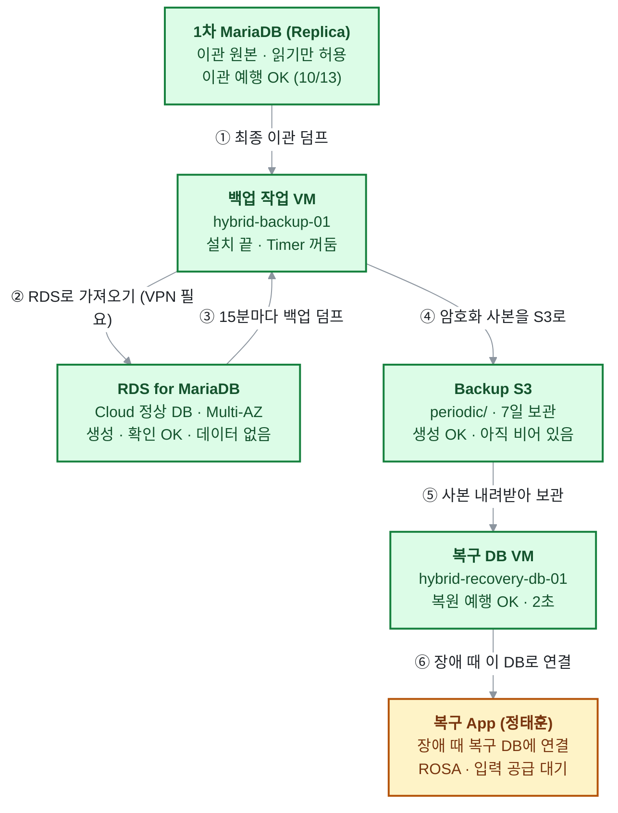
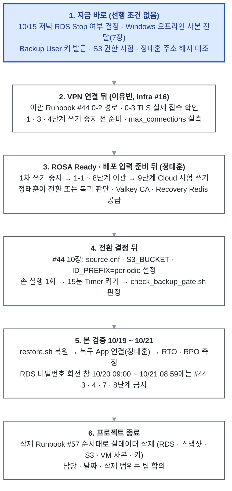

# 석판 2차 Data 영역 인수인계

2026-10-13 · 김상희

김상희가 2026-10-13부로 프로젝트에서 하차하면서, Data · Storage · Recovery 영역(1차 데이터 이관 · 15분 백업 · 온프렘 복원)을 이어받을 팀원을 위해 만든 문서입니다. 이 문서만 읽고도 "지금 어디까지 왔고, 무엇이 어디에 있고, 다음에 무엇을 하면 되는지" 알 수 있게 정리했습니다.

- **기준 시각:** 2026-10-13 22:00 KST(하차 정리 반영). 이후 바뀐 내용은 각 GitHub Issue 본문(Runbook 최신 기준본)이 우선입니다.
- **시간이 없으면:** 0장(현재 상태) → 5장(앞으로 할 일) → 7장(하차에 따라 정리할 것)만 먼저 읽으세요.
- **비밀값:** 이 문서에는 비밀번호 · Token · 개인키 · AWS 계정 번호가 없습니다. 비밀값은 "어디에 있고 누가 열 수 있는지"만 적었습니다.
- **AI에게 이어서 시킬 때:** 같은 폴더의 [`seokpan-data-handoff-for-ai.md`](seokpan-data-handoff-for-ai.md) 파일을 AI에게 먼저 읽히세요. 내용은 이 문서와 같고, AI가 읽기 쉬운 구조로 되어 있습니다.

## 0. 한눈에 보는 현재 상태

준비는 거의 끝났고, 실제 데이터는 아직 RDS에 들어가지 않았습니다. 남은 일 대부분은 VPN과 ROSA가 열려야 시작할 수 있습니다.

1. **준비 완료:** 설계 · 코드 · 절차(Runbook)는 100%입니다. AWS Data 자원(RDS · Valkey · Backup S3)은 10/13 16:12에 생성됐고, 설정 확인도 문제없이(NG 0) 끝났습니다.
2. **아직 안 한 것:** 1차 데이터를 RDS로 옮기는 실제 이관, 15분 백업 시작, 복원 본 검증(RTO · RPO 측정)은 VPN · ROSA가 준비된 뒤에 할 수 있습니다.
3. **바로 정해야 할 것:** ① 10/15 저녁 RDS를 멈출지(비용) ② Windows 오프라인 사본 전달과 ksh 공용 계정 규칙 공유(7장).

| 구분 | 진행도 | 무엇이 끝났고 무엇이 남았나 |
| --- | --- | --- |
| 설계 | 100% | 03 상세설계 기준 Data 결정 모두 확정 |
| 코드 · 절차 | 100% | Terraform Data 코드, 백업 · 복원 · 확인 스크립트, Runbook 5개(Issue #44 · #45 · #46 · #48 · #57) |
| 환경 준비 | 약 89% | AWS 자원 · 온프렘 VM 2대 · 키 · 인증서 준비 끝. VPN · ROSA 대기 |
| 실행 검증 | 약 52% | 온프렘 예행(백업 → 복원)은 끝. 실제 RDS 이관 · S3 백업 · 본 복원은 미실행 |
| 전체 | 약 86% | Data 7개 영역 × 4단계 = 28칸 중 24칸 |

> 초록 = 준비 끝, 노랑 = 다른 작업 대기. 실제 RDS · S3를 거친 실행은 아직 없음(온프렘 예행만 완료). 2026-10-13 22:00 기준.

①은 1차 데이터를 한 번 옮기는 길, ③ \~ ⑤는 그 뒤 15분마다 반복되는 백업 길입니다. ⑥은 AWS가 쓸 수 없는 장애 때만 씁니다.

일정 기준: Technical Freeze 10/16 · 본 검증 10/19\~21 · Demo Freeze 10/22 · 발표 10/26. RDS Multi-AZ와 Valkey 2노드는 10/13 16:12부터 요금이 나가고 있습니다.

## 1. 담당 범위와 기준 문서

Data 영역은 "정상 서비스는 AWS에서, 장애 때는 온프렘에서 백업으로 다시 살린다"(B1 구조) 중 데이터 쪽 전부를 맡습니다.

| 범위 | 내용 | 같이 일하는 사람 |
| --- | --- | --- |
| Cloud DB | RDS for MariaDB 11.8.9 Multi-AZ (`seokpan-fnd-mariadb`) — 정상 서비스의 주 DB | 이유빈(Terraform 통합 · Apply) |
| Cloud 캐시 | ElastiCache Valkey 7.2 2노드 (`seokpan-fnd-redis`) — 게임 진행 상태, 백업 대상 아님 | 이유빈 · 정태훈 |
| 데이터 이관 | 1차 온프렘 MariaDB(`stone_game` DB, 테이블 8개, 약 0.36MB)를 논리 덤프로 RDS에 한 번 옮김. 실사용자 데이터 그대로 | 정태훈(1차 쓰기 중지 · 전환 판단) |
| 백업 | 15분마다 RDS 덤프 → gzip → age 암호화 → S3 `periodic/` → 온프렘 복구 DB VM에 사본 확보, 7일 보관 | 최유준(비용 · 측정) |
| 복원 | 장애 때 AWS 없이 복구 DB VM에 복원 → 복구 App 연결. 목표 RTO 10분 · RPO 30분 | 정태훈(복구 App) · 최유준(Evidence) |
| 정리 | 프로젝트 종료 때 실사용자 데이터가 든 RDS · 스냅샷 · S3 · VM 사본 삭제 | 팀 전체 |

**실행 책임(04 문서 2.2절 "역할과 공유 실행 책임"):** bootstrap · foundation Terraform 실행은 이유빈, rosa는 정태훈입니다. Data 담당은 Data 코드를 쓰고, 데이터 이관 · 복원 실행을 맡습니다. 다른 사람 담당 작업을 대신 했으면 "배정 실행자 / 실제 수행자"를 나눠 기록합니다.

**기준 문서(docs 저장소 main이 최신):**

- `design/03_DETAILED_DESIGN.md` — 상세설계. 백업은 3-D.9절, DR 목표는 3-I.14절("복구 설계 재검토")
- `design/04_IMPLEMENTATION_READINESS.md` — 역할 · Secret 보관 책임(5.3절) · 복구 DB 전용 VM(5.5절)
- `execution/05_IMPLEMENTATION_AND_VALIDATION.md` — 진행 기록. Data 작업은 8장(8.10절 \~ 8.29절)
- `execution/WORK_TRACKER.md` — 담당별 진행표("김상희" 행을 후임 이름으로 바꿔야 함)
- Data 계약 v2.4 — [Infra #19 코멘트](https://github.com/seokpan/seokpan-hybrid-infra/issues/19#issuecomment-6143942560). App · GitOps가 Data에서 받는 값(Secret · ConfigMap 이름, 연결 수 예산, TLS)의 약속

## 2. 오늘(10/13) 한 작업

오늘은 "VPN 전에 Data 쪽에서 할 수 있는 준비"를 거의 다 끝냈습니다. 가장 큰 일은 이유빈의 foundation Apply(16:12)로 생긴 AWS 자원을 확인하고, 이관 · 복원 절차를 실제 값에 맞게 고친 것입니다.

| 시간대 | 한 일 | 결과 | 기록 |
| --- | --- | --- | --- |
| 밤 (2) | 10/15 RDS Stop 절차에 "이관 전" 분기 추가 | 아직 데이터가 없을 때는 사본 확인 대신 근거 4가지(이관 안 함 · 접속 0회 · 백업 Timer 꺼짐 · ROSA 없음)로 Stop 가능. 실제 Stop은 아직 안 함 | [Infra #45](https://github.com/seokpan/seokpan-hybrid-infra/issues/45) v1.4 |
| 밤 (2) | Data 계약 v2.4 | 복원 뒤 RPO(30분) 판정 방법 한 줄 추가 | [Infra #19](https://github.com/seokpan/seokpan-hybrid-infra/issues/19#issuecomment-6143942560) |
| 밤 | RDS 마스터 비밀번호(Secrets Manager) 확인 | 읽기 문제없음. **7일 자동 회전** — 다음 회전 창 10/20 09:00 \~ 10/21 08:59 KST | Infra #19 |
| 밤 | 이관 Runbook v2.5 | 인계 파일에서 RDS 주소 등을 자동으로 읽고, 회전 창이면 멈추게 함 | [Infra #44](https://github.com/seokpan/seokpan-hybrid-infra/issues/44) |
| 밤 | 확인 스크립트 2개를 저장소로 | `check_data_handoff.sh` · `check_rds_master_secret.sh` + 회귀 시험 11개, 리뷰 BLOCKER 2건 반영 | [Infra PR #66](https://github.com/seokpan/seokpan-hybrid-infra/pull/66) |
| 밤 | RDS CA · 값 전달 경로 · 계약 v2.3 | RDS CA는 공식 주소 + 해시로 정태훈에게 전달(확인 완료). RDS · Valkey 주소는 정태훈이 이유빈의 인계 파일을 직접 읽도록 정리(읽기 권한 대기) | Infra #19 |
| 저녁 | foundation Apply 뒤 Data 확인 | 54개 항목 모두 OK(NG 0). 확인 스크립트 오판 1건 수정 | [Infra PR #62](https://github.com/seokpan/seokpan-hybrid-infra/pull/62) |
| 저녁 | Terraform 재-Plan 차이 제거 | RDS TLS 파라미터의 적용 방식 차이 → `pending-reboot`로 고정, 이유빈 재-Plan 변경 0 | [PR #63](https://github.com/seokpan/seokpan-hybrid-infra/pull/63) · [PR #64](https://github.com/seokpan/seokpan-hybrid-infra/pull/64) |
| 저녁 | Data 출력값 인계 받음 | 이유빈 보호 폴더의 출력 11개를 실제 자원과 대조, 일치 | [Infra #23](https://github.com/seokpan/seokpan-hybrid-infra/issues/23) |
| 오후 | controller 없이 복원하기 | `restore.sh`에 `--key` · `--local` 추가. 이유빈이 이유빈 키로 복구 DB VM 콘솔에서 복원 예행 성공(4분 43초, USB 연결 시간 제외) | [Infra #60](https://github.com/seokpan/seokpan-hybrid-infra/issues/60) · [PR #61](https://github.com/seokpan/seokpan-hybrid-infra/pull/61) |
| 정오 | 이관 예행(1차 조회만) | 1 · 1-1 · 2단계 모두 OK. 덤프 1초 미만, 암호문 20,423바이트 | Infra #44 v2.2 |
| 오전 | 쓰기 중지 끝점 변경 | 1차 쓰기 중지는 9단계 뒤 정태훈의 전환/복귀 판단까지 유지 | Infra #44 v2.1 |
| 오전 | Recovery Redis 보호 입력 | 전용 CA · 서버 인증서 · AUTH Token을 SOPS 파일 하나로 만들어 3명(김상희 · 이유빈 · 정태훈) 해독 확인 | Infra #19 |

오늘 docs 기록: 05 문서 8.24절 \~ 8.29절(docs PR #109 · #111 · #113 · #116 · #118 · #120 · #122).

## 3. 지금까지 진행한 작업

9/29부터 10/13까지 Data 영역의 설계 · 코드 · 온프렘 환경 · 예행을 모두 끝냈습니다. 날짜별 자세한 내용은 docs 05 문서 8.10절 \~ 8.29절에 있습니다.

| 날짜 | 한 일 | 핵심 결과 |
| --- | --- | --- |
| 10/13 | 2장 참고 | AWS 자원 확인 NG 0, controller 없는 복원, 이관 예행 |
| 10/12 | S3 실패 사본 재전송 후속 · 설치본 교체 · 이관 Runbook v2.0 | 재전송을 회차 기록 뒤로 옮김([PR #59](https://github.com/seokpan/seokpan-hybrid-infra/pull/59)). RDS 계정 준비(3 · 4단계)를 쓰기 중지 전으로 옮김 |
| 10/8 | 백업 · 복원 실제 구현과 예행 | 백업 스크립트 · 15분 Timer · 받기 전용 계정 설치. 첫 백업 → 복원 23초 → `restore.sh`로 2초. Timer 1시간 4회 정확히 15분. 스크립트 저장소 기준본([PR #53](https://github.com/seokpan/seokpan-hybrid-infra/pull/53)), S3 재전송([PR #56](https://github.com/seokpan/seokpan-hybrid-infra/pull/56)), 삭제 Runbook([#57](https://github.com/seokpan/seokpan-hybrid-infra/issues/57)) |
| 10/7 | 온프렘 VM 2대 · 키 · 인증서 | 백업 작업 VM(Server-02) · 복구 DB VM(Server-04) 생성. 백업 해독 키 2명, SQL 비밀번호 SOPS, Recovery CA · TLS 강제, Runbook을 Issue로 운영 시작(#44 · #45 · #46) |
| 10/6 | Data 계약 · Terraform Data 코드 | Data 계약 v2 → v2.2(Valkey 7.2 전환 반영). foundation Data 코드 main 반영([PR #37](https://github.com/seokpan/seokpan-hybrid-infra/pull/37)), Data 권한([PR #34](https://github.com/seokpan/seokpan-hybrid-infra/pull/34)), Redis Token SOPS 3명 |
| 10/2 | 1차 DB 점검 · 이관 범위 결정 | MariaDB 11.8.9 · 테이블 8개 · 0.36MB. 실사용자 데이터 그대로 이관 결정([Infra #17](https://github.com/seokpan/seokpan-hybrid-infra/issues/17)) |
| 10/1 \~ 10/2 | 저장소 · Terraform 기반 | 저장소 4개, State 백엔드, TF 실행 Role 3개, MFA 세션 스크립트(배정 이유빈 / 실제 김상희) |
| 9/29 | VPN 사전 검증 | EC2 WireGuard 1대 방식으로 강의실 ↔ AWS 연결 검증 |

**한 번 정해진 큰 결정(바뀌지 않음):**

- 덤프는 백업 작업 VM의 MariaDB 11.8.9 클라이언트로만(controller의 10.5 클라이언트 사용 금지)
- RDS 마스터 비밀번호는 RDS가 관리(Secrets Manager), Valkey Token은 State에 남지 않는 방식, Backup User 키는 Terraform 밖에서 발급 → 비밀값이 Terraform State에 없음
- 백업 해독 키는 각자 키 1개, 받는 사람 2명(김상희 · 이유빈). 개인키는 주고받지 않음(하차 뒤 김상희 키는 ksh 공용 계정 안에서 팀이 사용)
- 공개 기록(Issue · PR)에는 실제 주소 · ARN · ID 대신 일치 여부와 해시(SHA-256 앞 12자리)만

## 4. 지금 무엇이 어디에 있나

자원은 AWS 4개, 온프렘 VM 2대, controller 작업 폴더 1개, infra 저장소 1곳에 나뉘어 있습니다. 아래 상태는 10/13 22:00 기준입니다.

### 4-1. AWS (서울 리전, 10/13 16:12 이유빈 Apply)

| 자원 | 이름 | 지금 상태 |
| --- | --- | --- |
| RDS for MariaDB | `seokpan-fnd-mariadb` | 사용 가능 · Multi-AZ · 삭제 보호 켜짐 · **데이터 없음**(접속 0회). 마스터 비밀번호 7일 자동 회전 |
| ElastiCache Valkey 7.2 | `seokpan-fnd-redis` | 2노드 · TLS + AUTH · 중지 기능 없음(계속 과금) |
| Backup S3 | `seokpan-fnd-backup-<계정번호>` | 비어 있음. `periodic/`(7일) · `protected/`(보존) |
| Backup IAM User | `seokpan-fnd-backup` | 있음 · **Access Key 아직 발급 안 함** |
| Data 보안 그룹 2개 | `seokpan-fnd-rds` · `seokpan-fnd-redis` | RDS는 백업 작업 VM `/32` 하나만 3306 허용. ROSA Worker 규칙은 rosa 쪽이 추가 |

NAT · VPN · ROSA는 아직 없습니다. Data 출력값 11개는 이유빈 controller 보호 폴더의 `c-data-outputs.json`에 있습니다(Infra #23).

### 4-2. 온프렘 VM 2대

| VM | 위치 · 주소 | 하는 일 | 지금 상태 |
| --- | --- | --- | --- |
| 백업 작업 VM `hybrid-backup-01` | Server-02 · `192.168.52.50` | 이관 덤프, 15분 백업(RDS 덤프 → 암호화 → S3 → 복구 DB VM) | 도구 설치 끝 · **Timer 꺼짐** · `source.cnf` 없음 · `backup.env`의 `ID_PREFIX=rehearsal`(전환 때 `periodic`으로 바꿔야 함) |
| 복구 DB VM `hybrid-recovery-db-01` | Server-04 · `192.168.54.60` | 백업 사본 보관, 장애 때 MariaDB 복원 | MariaDB 11.8.9 · TLS 강제 · 3306은 Worker 2대만 허용. `stone_game` 없음 · 사본 폴더 비어 있음 · 복구 계정 6개만 미리 있음 |

접속: controller → 백업 작업 VM은 root 비밀번호 SSH(명령마다 입력), controller → 복구 DB VM은 전용 SSH 키(`ksh` 계정에 등록. 팀원은 ksh로 로그인해 그대로 사용, 7장 참고).

### 4-3. 스크립트와 Runbook

스크립트 기준본은 infra 저장소 `ansible/data/`이고, 설치본은 기준본과 해시가 같습니다.

| 파일 | 하는 일 | 설치 위치 |
| --- | --- | --- |
| `backup-vm/seokpan-hybrid-backup` (+ service · timer) | 15분 백업 한 회차 | 백업 작업 VM `/usr/local/sbin/` |
| `recovery-db-vm/seokpan-recv-copy` | 사본 받기(SHA-256 대조) | 복구 DB VM `/usr/local/sbin/` |
| `controller/restore.sh` | 복원 0\~4단계 한 번에(사본 선택 · 해독 · 가져오기 · 검증) | controller `~/recovery/` · 복구 DB VM `/usr/local/lib/seokpan-hybrid-recovery/` |
| `controller/table_hashes.sh` | 테이블 8개 행 수 · 행 해시 비교 | 위와 같음 |
| `controller/check_data_apply.sh` | Apply 직후 AWS Data 자원 확인 | controller `~/recovery/` |
| `controller/check_backup_gate.sh` | 15분 백업이 제대로 도는지 판정 | controller `~/recovery/` |
| `controller/check_data_handoff.sh` · `check_rds_master_secret.sh` | 출력 인계 · 마스터 비밀번호 확인 | controller `~/recovery/` |

| Runbook (Issue 본문이 최신) | 판 | 내용 |
| --- | --- | --- |
| [Infra #44](https://github.com/seokpan/seokpan-hybrid-infra/issues/44) | v2.5 | 1차 → RDS 이관 0\~10단계 |
| [Infra #45](https://github.com/seokpan/seokpan-hybrid-infra/issues/45) | v1.4 | RDS Stop / Start |
| [Infra #46](https://github.com/seokpan/seokpan-hybrid-infra/issues/46) | v1.4 | 복구 DB VM 구성 기준 |
| [Infra #48](https://github.com/seokpan/seokpan-hybrid-infra/issues/48) | v1.5 | 복원 절차(C장 = controller 없이) |
| [Infra #57](https://github.com/seokpan/seokpan-hybrid-infra/issues/57) | — | 종료 때 실데이터 삭제 D1\~D8 |

### 4-4. 비밀값 (값은 적지 않음)

| 비밀값 | 위치 | 열 수 있는 사람 |
| --- | --- | --- |
| Valkey AUTH Token | `~/secrets/seokpan/foundation-data.sops.yaml` | 김상희 · 이유빈(`ansible`) · 정태훈(`jth`) |
| Cloud SQL 계정 비밀번호 4개 | `~/secrets/seokpan/data-sql-accounts.sops.yaml` | 같은 3명 |
| 복구 DB SQL 비밀번호 3개 | `~/secrets/seokpan/recovery-sql-accounts.sops.yaml` | 같은 3명 |
| Recovery Redis 인증서 · 키 · Token | `~/secrets/seokpan/recovery-redis.sops.yaml` | 같은 3명 |
| RDS 마스터 비밀번호 | AWS Secrets Manager(RDS 관리) | IAM 사용자 4명 누구나(personal MFA 세션) |
| 백업 해독 키 | 김상희: controller `ksh` · 이유빈: `ansible` 계정 + 잠금 사본(이유빈 USB) | 김상희 키: ksh로 로그인한 팀원 · 이유빈 키: 이유빈 본인 |
| Recovery DB CA 개인키 | controller `ksh` `~/secrets/seokpan/recovery-ca/` + 오프라인 사본 | 암호 문구 = 팀 공통 비밀번호(ksh 계정으로 로그인해 사용) |
| Recovery Redis CA 개인키 | controller ksh \~/secrets/seokpan/recovery-redis-ca/ + 오프라인 사본 | 암호 문구 = 팀 공통 비밀번호(ksh 계정으로 로그인해 사용) |

파일 경로는 각자 홈 기준입니다(김상희 = `ksh`). SOPS 파일은 3계정에 같은 파일이 있고, 김상희 몫(ksh)은 이제 ksh로 로그인한 팀원이 씁니다. 이 몫을 여는 SOPS용 age 개인키는 ksh \~/.config/sops/age/keys.txt에 있고, 오프라인 사본 4개(CA 2 · 백업 키 · SOPS 키)의 위치는 7-3절에 있습니다.

### 4-5. 김상희 Windows PC(교육장 PC `desktop-qacm9s0`, 사용자 `soldesk`)에 있는 파일

**작업에 꼭 필요한 파일은 PC에 없습니다.** 스크립트 · 패치의 기준본은 infra 저장소 `ansible/data/`, 설치본은 controller와 VM에 있습니다. PC에는 내려받은 사본 · 작업 초안 · 오프라인 사본(보안 폴더)이 있고, 10/14에 두 곳을 확인했습니다. 아래 첫 표는 `C:\Users\soldesk\Downloads`, 두 번째 표는 프로젝트 작업 폴더입니다.

| 파일 | 내용 | 처리 |
| --- | --- | --- |
| `vpn-onprem-aws-proposal.md` · `vpn-report.zip` · `vpn-test-report.pdf` (9/29) | 강의실 ↔ AWS WireGuard VPN 사전 검증(PoC) 보고서와 제안 | **이유빈에게 전달 권장** — VPN 구축(Infra #16)에 바로 참고. 교육장 출구 공인 IP가 들어 있어 Public 저장소에는 올리지 않음 |
| `check-db-runtime (1).sh` · `.zip` (10/7) | lab DB 실행 Gate 확인 스크립트(조회만, 최유준이 실행, GitOps #26). 저장소에 없는 유일한 사본 | 선택 — lab 시험을 다시 할 때만 필요 |
| `RDS_SSL_권한_검토.md` (10/2) | RDS TLS 강제 방식 · `db_admin` 권한 검토(팀 공유용) | 이력 — Data 계약 v2.4가 대신함 |
| `data-root-switch.patch` · `pr37-review-fix.patch` (10/6) | Data Root 전환 패치 | 필요 없음 — PR #37로 main에 반영됨 |
| `README.md` (10/2) · `terraform-version-guide.md` (10/1) | infra README 초안 · 폐기된 버전 안내 | 필요 없음 — 저장소 README가 최신 |
| `seokpan-2nd-worklog.md` (10/1) | worklog 초기판 | 필요 없음 — 최신판은 Project 지식(10/13) |
| `progress-20261007-*.png` | 10/7 진행도 그림 | 필요 없음 |
| `terraform.json` (10/2) | **Terraform State 파일 사본**(계정 번호 포함) | **공유 금지 · 삭제 권장** — 정본은 S3 State 버킷 |
| `event_history.json` (10/13) | **CloudTrail 이벤트 기록 내보내기**(계정 번호 · Access Key ID · IP 포함, foundation Apply 분석용) | **공유 금지 · 삭제 권장** |

**프로젝트 작업 폴더 `C:\하이브리드 클라우드 09\Project\2차\`** (김상희가 2차 준비에 쓴 폴더, 10/14 확인)

| 폴더 · 파일 | 내용 | 처리 |
| --- | --- | --- |
| `보안\` | 오프라인 사본 4개(7-3절) | **후임에게 전달** |
| `VPN 연결\` (README · TEST-PROCEDURE · vpn-report.zip) · `vpn-report\` | VPN PoC 보고서와 시험 절차 | **이유빈에게 전달 권장**(공인 IP 포함 — 팀 내부만) |
| `스크립트\` | 확인 · 복원 스크립트 5개 | 쓰지 않음 — `table_hashes.sh` · `check_rds_master_secret.sh`만 저장소와 같고, `restore.sh` · `check_data_apply.sh` · `check_backup_gate.sh`는 **옛 판**(10/8). 항상 저장소 `ansible/data/`에서 받기 |
| `패치파일\` | 패치 8개(restore-local · data-resend-checks · pr56 · pr66 등) | 필요 없음 — 모두 PR로 main에 반영됨 |
| `문서\` | 00\~04 설계 문서 사본 · Data 계약 v2 · v2.2 · lab Redis 기준 · 이관 Runbook v1 · worklog(10/13 21:24) · Valkey 안내 그림 | 이력 — 최신은 docs 저장소 · #19 · #44 · Project 지식 |
| `foundation-data-draft\` · `HANDOFF_foundation_data.md` · `link-fix-20261008\` · `data-resend-checks-pr.md` | 10/1 \~ 10/8 작업 초안 · 링크 일괄 수정 작업물 | 필요 없음 |
| `실습환경\` | OCP 실습 서버 접속 정보(RDP · 환경정보 xlsx) | 교육기관 제공 자료 — 접속 정보가 들어 있으니 팀 내부에서만 |
| `기획안\` · `아키텍처\` · `이미지\` | 기획안 · 아키텍처 그림 | 팀 공용 자료와 같음 |

교육장 PC는 다른 사람도 쓸 수 있으므로, 하차하면서 `terraform.json` · `event_history.json`은 지우는 것이 안전합니다.

## 5. 앞으로 해야 할 작업

남은 일은 6단계이고, 1단계만 지금 바로 할 수 있습니다. 2단계부터는 VPN(이유빈) → ROSA(정태훈) 순서로 앞 작업이 열려야 시작됩니다.

> 위에서 아래로 진행. 파란 칸만 지금 바로 할 수 있음.

각 단계는 앞 단계가 끝나야 시작할 수 있고, 아래 표가 단계별 자세한 조건입니다.

### 5-1. 지금 바로 할 수 있는 일

- [ ] **10/15 저녁 RDS Stop 여부 팀 결정** — 이관 전이면 #45 v1.4의 3-0 분기(근거 4가지 확인)로 Stop. 다시 켜서 `available` · 주소 해시만 확인. 걸린 시간을 재서 #45 v1.5로 기록
- [ ] **7장의 하차 정리**(Windows 오프라인 사본 전달)
- [ ] **Backup User Access Key 발급 + S3 권한 시험**(#44 10-2단계를 앞당김, 팀 확인 후) → 실제 S3 재전송 확인(V4, [Infra #55](https://github.com/seokpan/seokpan-hybrid-infra/issues/55))
- [ ] **정태훈 해시 대조 확인** — 이유빈이 `c-data-outputs.json`에 `jth` 읽기 권한을 주면, 정태훈이 RDS · Valkey 주소 해시 4개를 대조 → Data 계약 v2.4의 ⏳ 표시를 ✅로 고치고 #19에 한 줄
- [ ] (선택) 회귀 시험 자동 CI(PR #66 리뷰 의견)

### 5-2. 앞 작업이 열려야 하는 일

| 순서 | 할 일 | 시작 조건 | 참고 |
| --- | --- | --- | --- |
| 2 | 경로 · TLS 실제 접속 확인(#44 0-2 · 0-3) → 1 · 3 · 4단계(쓰기 중지 전 준비) · `@@max_connections` 실측 | VPN 연결([Infra #16](https://github.com/seokpan/seokpan-hybrid-infra/issues/16), 이유빈) | Infra #44 |
| 3 | 1차 쓰기 중지 → 1-1 · 2 · 5 · 6 · 7 · 8단계 → 9단계 Cloud 시험 쓰기(정태훈) → 전환 또는 복귀 판단 | ROSA Ready · 배포 입력 준비 | Infra #44, docs PR #107 |
| 3 | Valkey CA 체인 확인(`openssl s_client`) → `backend-redis-ca` 공급, Runtime 계정 출발지 IP 확인 | ROSA | Data 계약 v2.4 |
| 3 | Recovery Redis Secret 3개 · ConfigMap 2개를 `seokpan-recovery`에 공급 → Token 해시 대조 | 정태훈이 공급 경로 결정 | Infra #19 |
| 4 | #44 10장: `source.cnf`(RDS용) · `S3_BUCKET` · **`ID_PREFIX=periodic`** 설정 → 손 실행 1회 → Timer 켜기 → `check_backup_gate.sh` 판정 | 3단계에서 "전환" 결정 | Infra #44 10-1 \~ 10-8 |
| 5 | 본 검증: `restore.sh` → 복구 App 연결(정태훈) → RTO · RPO 측정(T18) | 실제 `periodic` 백업이 쌓인 뒤, 10/19 \~ 21 | Infra #48 |
| 6 | 실데이터 삭제(RDS · 최종 스냅샷 · S3 모든 버전 · VM 사본 · 키) | 담당 · 날짜 · 삭제 범위 팀 합의 | Infra #57 |

**꼭 기억할 날짜:** RDS 마스터 비밀번호 회전 창 **10/20 09:00 \~ 10/21 08:59 KST**에는 #44의 3 · 4 · 7 · 8단계(마스터 비밀번호 사용)를 시작하지 않습니다. RDS는 Stop해도 7일이 지나면 저절로 켜지므로 6일째에 손으로 Start합니다.

**#44를 실행할 때 주의:** 쓰기 중지 구간(1-1 \~ 9단계)은 Data 몫 약 39분, 전체 예산 75분입니다. 6단계 비교가 맞아도 1차 쓰기는 다시 열지 않습니다. 9단계 시험 쓰기 뒤 복귀하기로 하면, 이번 RDS 데이터는 버리고 1-1단계부터 새로 덤프합니다.

## 6. 회신을 기다리는 질문

김상희가 팀원에게 물어 두고 아직 답을 받지 못한 질문은 12개입니다. 이제 답은 Data 후임이 받아, 오른쪽 칸의 작업을 이어서 하면 됩니다.

| 답할 사람 | 질문 | 답이 오면 할 일 |
| --- | --- | --- |
| 이유빈 | VPN 경로와 출발지 IP 보존(백업 작업 VM `.52.50`이 RDS에 그대로 보이는지) | #44 0-2 · 0-3 확인 ([Infra #16](https://github.com/seokpan/seokpan-hybrid-infra/issues/16)) |
| 이유빈 | `c-data-outputs.json`에 정태훈 `jth` 읽기 권한 추가 | 정태훈 해시 대조 → 계약 ⏳ 정리 |
| 정태훈 | 받은 RDS · Valkey 주소 해시 4개 대조 결과 | Data 계약 v2.4 2.1 · 5 · 6절 ✅ |
| 정태훈 | 1차 쓰기 중지 실제 경로 · 계정(Argo CD 자동 Sync 때문에 `scale`만으로는 안 멈출 수 있음) | #44 1-1단계 실행 계획 (docs PR #91 · #107) |
| 정태훈 | 9단계 뒤 "복귀"로 결정하면 RDS `stone_game`을 어떻게 처리할지 | #44 9단계 문구 확정 |
| 정태훈 | Recovery Redis Secret · ConfigMap을 `seokpan-recovery`에 넣는 경로(사전 Render Bundle / Ansible) | 5-2의 Recovery Redis 공급 |
| 정태훈 | Valkey 7.2.14 이미지에 `redis-server` 실행 파일이 있는지 | Recovery Redis 기동 명령 확정 |
| 정태훈 | DB 연결 Pool 상한(App이 Pool 환경변수를 읽게 되는지) | 연결 예산 확정(`max_connections` 85 미만) |
| 정태훈 | 복구 App Pod의 출발지 IP | 복구 DB 3306 허용 범위 확인 |
| 정태훈 | rosa Data SG 입력 반영(`mariadb` ← RDS SG, `redis` ← Redis SG — 서로 바뀌지 않았는지) | Apply 직후 이름 대조 |
| 최유준 | Valkey 단가 반영한 Cost Gate 재계산 | [Docs #43](https://github.com/seokpan/seokpan-hybrid-docs/issues/43) Data 행 갱신 |
| 최유준 · 팀 | 10/22 이후 RDS 운영(시연 구간만 / Stop / 삭제 — 의견이 갈림) | #45 10/22 이후 절 |

참고: 김상희가 10/13 팀에 의견으로 낸 마감 일정안(10/16까지 Apply · ROSA · 부하 시험 뒤 AWS 전부 종료, 10/23 재구성, 10/26 16시 이후 전체 삭제)은 **팀 결정 전**입니다.

## 7. 하차에 따라 정리할 것

하차 정리는 대부분 끝났습니다. controller `ksh` 계정은 팀 공용 "온프렘 Data 작업 공간"으로 남기므로, 팀원은 팀 공통 비밀번호로 `ksh`에 로그인해 김상희가 쓰던 파일 · 키 · 스크립트를 그대로 이어서 쓰면 됩니다. 남은 것은 Windows 오프라인 사본 전달뿐입니다.

### 7-1. 하차 정리 결과 (10/13 22:00)

| 항목 | 결과 |
| --- | --- |
| `ksh_data` Access Key | 비활성화(Inactive) 확인. `ksh`에서 AWS 호출 안 됨. 콘솔 암호는 원래 비활성 |
| `ksh` MFA 세션 | `tf-session.sh clear`로 해제 |
| `ksh`의 GitHub 로그인(김상희 계정) | 유지 — 하차 뒤에도 김상희가 GitHub를 계속 쓰므로 그대로 둠. `ksh`에서 `git pull`은 되고 push는 안 됨 |
| GitHub 기록(Issue 담당자 · WORK\_TRACKER · Docs #8) | 보류 |
| Windows 오프라인 사본 | 7-3 참고 |

### 7-2. `ksh` 공용 계정 사용 규칙

- **접속:** 각자 PC에서 VS Code Remote-SSH 또는 ssh로 controller `ksh`(팀 공통 비밀번호). 접속한 PC와 상관없이 같은 파일이 보입니다.
- **`ksh`에서 하는 일:** `~/recovery/` 스크립트(백업 · 복원 · 비교), 백업 작업 VM(`ssh root@192.168.52.50`) · 복구 DB VM(`ssh seokpan-recovery`) 접속, SOPS 해독, CA 사용, `git pull`로 최신 스크립트 받기 → 설치 → 해시 대조.
- **`ksh`에서 하지 않는 일:** AWS 작업(키가 꺼져 동작 안 함), GitHub Issue · PR · 코멘트(`ksh`의 GitHub 로그인은 김상희 계정이라 기록이 김상희로 남음).
- **AWS가 필요한 단계는 각자 계정에서** `source scripts/tf-session.sh personal`로 합니다: #44 0-A의 `rot_check` · 3단계(마스터 비밀번호 읽기) · 10-1 · 10-2, `check_data_apply.sh` · `check_backup_gate.sh` · `check_rds_master_secret.sh`. 이때 스크립트는 저장소 `ansible/data/controller/`에서 자기 홈 `~/recovery/`로 복사하고 해시를 대조합니다. 백업 작업 VM은 root 비밀번호 SSH라 어느 계정에서도 접속됩니다. 이유빈의 Data 출력 인계 파일은 `ksh` · `jth`만 읽을 수 있으니, 다른 계정에서 읽어야 하면 이유빈에게 권한을 요청합니다. AWS와 복구 DB VM을 함께 조회하는 스크립트(예: check\_backup\_gate.sh)를 자기 계정에서 돌릴 때 복구 DB VM SSH가 막히면, 자기 계정 키를 복구 DB VM에 등록(#46 방식)해야 할 수 있으니 처음 실행할 때 확인합니다.
- **`restore.sh` 키:** `ksh`에서는 기본 키(김상희 백업 키)로 그대로 됩니다. 자기 계정이나 복구 DB VM 콘솔에서는 `--key <자기 키>`를 줍니다.
- **기록:** Issue · 05 문서에 "`ksh` 계정, 실제 수행자 ○○○"로 적습니다.
- **동시 사용 주의:** 두 사람이 `ksh`로 같은 폴더(`~/recovery/mig/` 등)를 동시에 쓰지 않도록, 작업 전에 팀 메신저에 알립니다.

**#44 이관 Runbook을 실행할 때 (중요):** #44 본문의 명령은 "controller (ksh) — personal 세션"으로 적혀 있지만, `ksh`는 이제 AWS를 쓸 수 없어 0-A · 3 · 10-2단계가 그대로는 실패합니다. **이관은 처음부터 끝까지 이유빈 `ansible` 계정에서 하는 것을 권장합니다.** `ansible`에는 이미 필요한 것이 다 있습니다: 자기 IAM · MFA(personal 세션), SOPS 파일(`data-sql-accounts`), 이유빈 백업 해독 키, Data 출력 인계 파일(이유빈 본인 폴더). 바꿀 것은 두 가지뿐입니다.

1. `ansible` 홈에 `~/recovery/`를 만들고 저장소 `ansible/data/controller/`의 `table_hashes.sh`를 복사한 뒤 해시(`5beac6da6e9c`)를 대조합니다.
2. 5단계 가져오기의 `age -d -i ~/secrets/seokpan/backup-age/backup-kimsanghee.key`를 이유빈 키 경로로 바꿉니다.

10-7단계(운영 Gate)만 복구 DB VM SSH 키가 필요해서, `ansible` 키를 복구 DB VM에 등록하거나 해당 확인을 `ksh`에서 나눠 실행합니다.

### 7-3. 남은 하차 정리 — Windows 오프라인 사본

- [ ] 아래 보안 폴더(파일 4개)를 후임에게 넘기고, 받은 쪽에서 해시를 대조합니다.
- [ ] (보류) GitHub 기록 — Issue 담당자 변경, `WORK_TRACKER.md`, Docs #8 인계 코멘트, 05 문서 8.30절

위치: **`C:\하이브리드 클라우드 09\Project\2차\보안\`** (김상희 교육장 PC). 10/14에 기록된 해시와 대조했고, 해독은 하지 않았습니다.

| 파일 | SHA-256 앞자리 | 내용 | 원본 |
| --- | --- | --- | --- |
| `recovery-ca-offline-20261007.tar.age` | `e6dfd7652b07dc63` (기록과 일치) | Recovery DB CA(`ca.key` · `ca.crt` · `server.ext` · `ca.srl`) | `ksh` `~/secrets/seokpan/recovery-ca/` |
| `recovery-redis-ca-offline-20261013.tar.age` | `b6a7e0643a78` (기록과 일치) | Recovery Redis CA(`ca.key` · `ca.crt` · `ca.srl`) | `ksh` `~/secrets/seokpan/recovery-redis-ca/` |
| `backup-kimsanghee.key.age` | `28c03eb0f8ce64b9` (기록과 일치) | 김상희 백업 해독 키 잠금 사본(이유빈 USB에도 같은 파일) | `ksh` `~/secrets/seokpan/backup-age/` |
| `keys.txt.age` (10/6) | `e49d45516847cc8d` | **김상희 SOPS용 age 개인키 잠금 사본** — SOPS 파일 4개(Valkey Token · SQL 비밀번호 · 복구 SQL 비밀번호 · Recovery Redis)의 김상희 몫을 여는 키 | `ksh` `~/.config/sops/age/keys.txt` |

네 파일 모두 `age -p` 암호 문구로 잠겨 있습니다(팀 공통 비밀번호인지 김상희 확인 필요). 후임에게 폴더째 넘기고, 받은 쪽에서 `Get-FileHash`로 위 값과 대조합니다.

네 파일 모두 원본은 controller `ksh` 계정에 그대로 있으므로, 오프라인 사본은 controller가 망가졌을 때를 위한 예비입니다.

### 7-4. 팀이 정해야 할 것

| 결정 | 선택지 | 비고 |
| --- | --- | --- |
| Data 후임 방식 | 이유빈 전담 / 3명 분담 | 분담이면 아래 표를 출발점으로 |
| 백업 받는 사람(김상희 키) 교체 | 유지(ksh 공용 키로 사용) / 새 보관자 키로 교체 | 유지하면 할 일 없음. 교체한다면 실제 백업이 0개인 지금이 가장 쉬움 |
| 10/15 RDS Stop | Stop / 계속 가동 | 이관 전이면 #45 3-0 분기 |
| 10/22 이후 RDS | 시연 구간만 / Stop / 삭제 | #45에 의견 모음 |
| 마감 일정안 | 채택 / 수정 | 6장 참고 |

분담할 경우 제안(각자 이미 하던 일과 가장 가깝게 나눔):

| 사람 | 맡을 Data 작업 | 이유 |
| --- | --- | --- |
| 이유빈 | 백업 작업 VM · 이관 0 \~ 8단계 · 10장 백업 시작 · RDS Stop/Start · 복원 실행 | VPN · VM · Apply 담당이고, 해독 키를 갖고 있으며 `--local` 복원 예행을 직접 성공함 |
| 정태훈 | 1차 쓰기 중지 · 9단계 전환 판단 · Recovery Redis 공급 · 복구 App 연결 | 이미 정태훈 담당이거나 App 쪽 작업 |
| 최유준 | Cost Gate Data 행 · 백업 Gate 판정 기록 · RTO/RPO Evidence · 삭제 Runbook 일정 조율 | 비용 · 측정 · Evidence Index 담당 |

## 8. 작업할 때 꼭 지킬 규칙과 자주 한 실수

아래는 실제로 실수가 났거나 리뷰에서 막혔던 것만 모았습니다. 특히 비밀값과 1차 DB 관련 규칙은 어기면 되돌리기 어렵습니다.

### 8-1. 지켜야 할 규칙

- **1차 DB는 읽기만.** 1차 MariaDB · MaxScale은 이관 원본일 뿐, 설정 변경 · 계정 추가 · 복원 대상으로 쓰지 않습니다. root 창은 확인이 끝나면 바로 닫습니다.
- **비밀값은 화면 · 기록에 남기지 않기.** Token · 개인키는 출력하지 않고, 공개 코멘트에는 실제 주소 · ARN · ID 대신 일치 여부와 해시만 씁니다. `tf-session.sh` 출력의 "실행 주체" 줄에는 계정 번호가 있어 붙이지 않습니다.
- **실데이터 취급 조건.** 덤프 · 행 내용은 저장소 · Issue · PR · Evidence에 올리지 않고(행 수 · 해시만), 만들자마자 age로 암호화하고, 종료 때 삭제합니다([Infra #17](https://github.com/seokpan/seokpan-hybrid-infra/issues/17)).
- **스크립트는 저장소가 기준.** 고칠 때는 infra PR → 설치 → 해시 대조 순서. 설치본을 직접 고치지 않습니다.
- **Runbook은 Issue 본문이 최신.** 본문을 고치면 맨 위 버전 줄도 올리고, 바뀐 내용은 코멘트로 이력을 남깁니다.
- **Apply는 지정 실행자만.** foundation은 이유빈, rosa는 정태훈. 다른 사람은 Plan 확인까지만 하고 "plan만"으로 기록합니다.
- **팀원에게 쓰는 글은 이름으로.** 역할 기호(A \~ D) 대신 이름을 쓰고, 작업 중에만 쓰던 약어는 풀어 씁니다.
- **다른 저장소 링크는 전체 주소로.** `#44`만 쓰면 그 코멘트가 있는 저장소의 44번으로 걸립니다.

### 8-2. 자주 한 실수

| 실수 | 결과 | 막는 법 |
| --- | --- | --- |
| 명령 예시의 `<...>` 자리표시를 그대로 붙여넣음 | 변수가 비고, 빈 입력 해시(`e3b0c442…`)가 "일치"처럼 보임 | 붙여넣기 전 자리표시 확인. 빈 값 해시도 실패로 봄 |
| 암호 문구를 묻는 명령을 블록으로 붙여넣음 | 남은 줄바꿈이 빈 암호 문구로 들어가 조용히 실패 | `ssh-add` · `age -p` · `openssl` 등은 한 줄씩 단독 실행 |
| `export A=$(cmd) && …` | `cmd`가 실패해도 성공으로 넘어감 | `A=$(cmd) && export A`로 나눔. 조건 확인은 `if … then … fi` |
| `age -p`에서 빈 Enter | 암호 문구를 자동으로 만들어 화면에 출력 | 반드시 직접 입력 |
| "문서용" 블록을 실행함 | 셸에 `umask` · `trap`이 남음 | 실행 전 "실행용인지 문서용인지" 확인 |
| 프롬프트 확인 없이 붙여넣음 | 다른 VM · 다른 폴더에서 실행(`chmod 600 *` 사고) | 호스트 · 계정 확인, `cd 경로 && 명령`으로 묶음 |
| VS Code로 파일을 끌어다 놓아 교체 | 실행 권한 빠짐(755 → 644) | 커밋 전 `git diff --summary`가 빈 출력인지 확인 |
| docs PR을 만들자마자 merge | 이후 수정이 main에 안 들어감 | 수정이 다 끝난 뒤 merge. docs는 리뷰 없이 작성자가 merge |
| 파일 이름만 보고 내용을 추정 | 잘못된 값 전달 경로 안내(`backend-reference.json`) | 받은 사람에게 키 이름(값 제외)을 먼저 확인 |
| MFA 세션 만료 후 조회 | "AWS 자격증명 없음"(종료 2) | `tf-session.sh` 세션은 1시간. 새 MFA 코드로 다시 발급 |

### 8-3. 판정에 쓰는 기준값

- 1차 원본: MariaDB 11.8.9, `stone_game`, 테이블 8개, Alembic `20260902_0002`, View · Routine · Trigger · Event 0개
- 이관 비교: 당일 최종 덤프 시점의 행 수 · 행 해시 · Schema 해시 · Revision(10/2 · 10/8 값은 이력)
- 복제 반영: Primary `gtid_binlog_pos`의 모든 도메인 값이 Replica `gtid_slave_pos`에 있는지 도메인 단위로 봄(과거 도메인 `2-2-43` 때문에 문자열 비교는 정상인데도 막힘)
- 백업 Gate: 15분 ± 60초 간격, 로컬 확보 지연 300초 이하, 데이터 나이 30분 이하. 종료 코드 0 = OK · 1 = NG · 2 = 판정 불가
- 복원 RPO: `restore.sh`는 30분 넘은 사본도 막지 않음 → 선택된 Backup ID 시각과 장애 시각(T0)을 사람이 대조

## 9. 링크 모음

| 구분 | 링크 | 내용 |
| --- | --- | --- |
| Runbook | [Infra #44](https://github.com/seokpan/seokpan-hybrid-infra/issues/44) | 이관 Runbook v2.5 |
| Runbook | [Infra #45](https://github.com/seokpan/seokpan-hybrid-infra/issues/45) | RDS Stop / Start v1.4 |
| Runbook | [Infra #46](https://github.com/seokpan/seokpan-hybrid-infra/issues/46) | 복구 DB VM 구성 v1.4 |
| Runbook | [Infra #48](https://github.com/seokpan/seokpan-hybrid-infra/issues/48) | 복원 절차 v1.5 |
| Runbook | [Infra #57](https://github.com/seokpan/seokpan-hybrid-infra/issues/57) | 종료 때 실데이터 삭제 |
| 계약 · 공급 | [Infra #19](https://github.com/seokpan/seokpan-hybrid-infra/issues/19) | foundation Data · Data 계약 · 비밀값 공급 기록 |
| 계약 | [Data 계약 v2.4](https://github.com/seokpan/seokpan-hybrid-infra/issues/19#issuecomment-6143942560) | App · GitOps와의 약속 |
| 인계 | [Infra #23](https://github.com/seokpan/seokpan-hybrid-infra/issues/23) | foundation 통합 · Data 출력 인계 |
| 1차 DB | [Infra #17](https://github.com/seokpan/seokpan-hybrid-infra/issues/17) | 1차 점검 · 이관 범위 · 실데이터 취급 조건 |
| VPN · 비용 | [Infra #16](https://github.com/seokpan/seokpan-hybrid-infra/issues/16) | VPN 가동 · 경로 |
| 백업 | [Infra #55](https://github.com/seokpan/seokpan-hybrid-infra/issues/55) | S3 실패 사본 재전송(실제 S3 확인 V4 남음) |
| 키 | [Infra #41](https://github.com/seokpan/seokpan-hybrid-infra/issues/41) | 백업 해독 키 2명 등록 방식 |
| 비용 | [Docs #43](https://github.com/seokpan/seokpan-hybrid-docs/issues/43) | Cost Gate Data 입력 |
| 인계 추적 | [Docs #8](https://github.com/seokpan/seokpan-hybrid-docs/issues/8) | 팀 인계 연결 |
| 발표 | [Docs #6](https://github.com/seokpan/seokpan-hybrid-docs/issues/6) | 발표 Evidence 후보 |
| 쓰기 중지 | [Docs PR #107](https://github.com/seokpan/seokpan-hybrid-docs/pull/107) | 정태훈 1차 쓰기 중지 준비 |
| App · GitOps | [App #1](https://github.com/seokpan/seokpan-hybrid-app/issues/1) · [GitOps #6](https://github.com/seokpan/seokpan-hybrid-gitops/issues/6) | Data 계약을 받는 쪽 |
| 진행 기록 | [05 문서](https://github.com/seokpan/seokpan-hybrid-docs/blob/main/execution/05_IMPLEMENTATION_AND_VALIDATION.md) | 8.10절 \~ 8.29절이 Data |
| 스크립트 | [ansible/data](https://github.com/seokpan/seokpan-hybrid-infra/tree/main/ansible/data) | 백업 · 복원 · 확인 스크립트 기준본과 README |
| Terraform | [terraform/foundation](https://github.com/seokpan/seokpan-hybrid-infra/tree/main/terraform/foundation) | `data_*.tf` 7개 |
